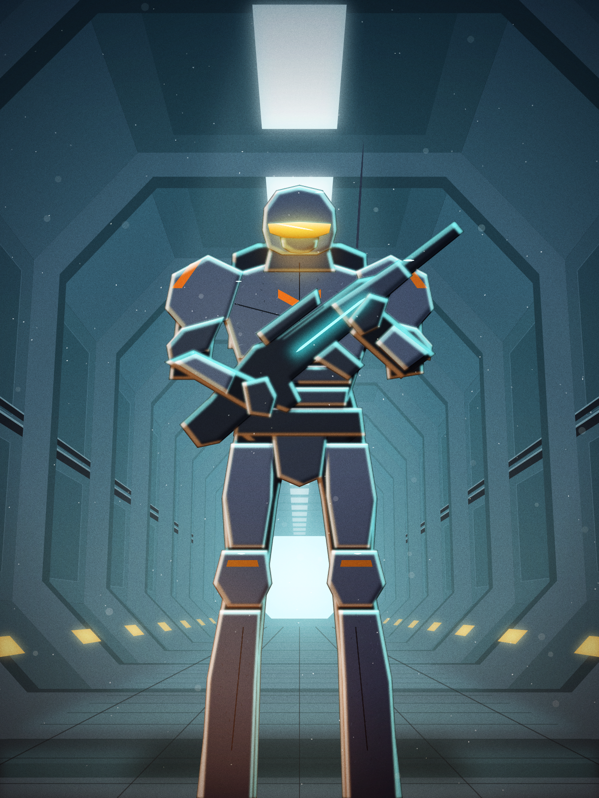
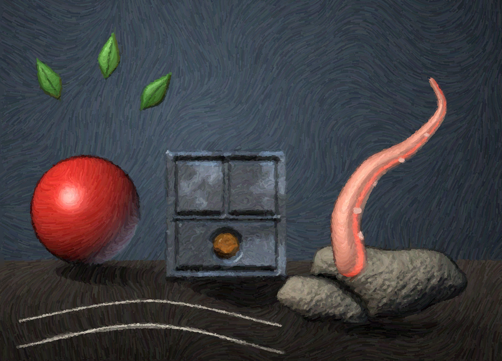
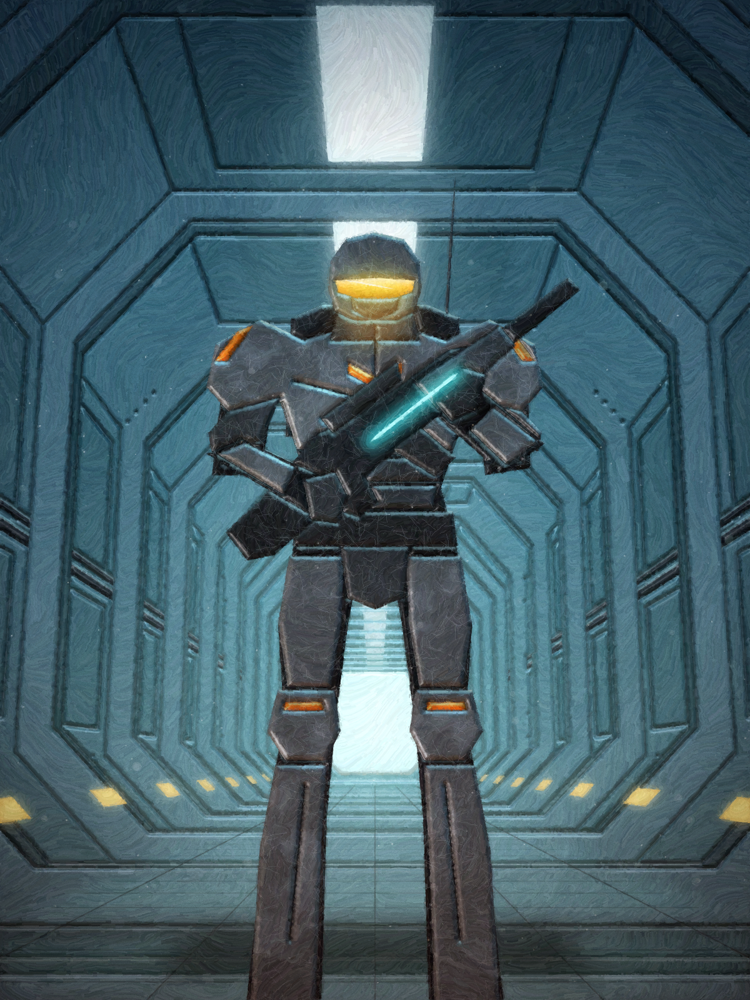

# Krita MCP

Lets Claude (or any [MCP](https://modelcontextprotocol.io) client) **paint in Krita**: Krita's brush engine with pressure, clean tapered ink, pencil and charcoal grain, gradient fills, SVG, blend modes, clipping, masks, shaped selections, soft blur, procedural marks (scatter, hatching), pixel art, layers, filters, and export to PNG/JPG/KRA. Every tool call is a single undo step.



*Painted entirely through the MCP's tools by [`examples/scifi_soldier.py`](examples/scifi_soldier.py): a projected low-angle hallway, the soldier built from depth-ordered parts, separate clipped shading, key and rim light layers, emissive glow with bloom, light beams, haze, dust, vignette, color grade and grain. All of it stays as editable layers in the saved `.kra`.*

## Realism tools (v0.3)

Paint parts flat, then let the server compute the light:


- **`render_form`** builds a height field from each flat-colored part and lights it: rounded, dome or beveled volume, key, fill and sky light, ambient occlusion, specular highlights, rim light, environment reflections on metal, and a warm glow at the shadow edge for skin and leaves. Materials: matte, plastic, metal, painted_metal, skin, cloth, stone, wood, glass, leaf.
- **Organic shapes:** `tube` (a spine with a radius at each point, for limbs, fingers, tentacles, branches) and `blob` (rocks, clouds, muscles) work in `paint`, `select` and `add_mask`.
- **`cast_shadow`** grounds objects with a projected shadow that's sharp at the contact point and softer farther away.
- **`texture`** adds grime, rust, scratches, stone, cell, fabric, grain and cloud patterns.
- **`painterly`** repaints with brush strokes that follow the forms, coarse to fine, with bristle texture:



- **Natural lines:** `draw_strokes(natural=0.5)` adds wobble, pressure and overshoot; `passes=3` gives a sketchy look.

The soldier scene again, with `render_form` on the hallway and armor, texture, and a 45% painterly layer (`python examples/scifi_soldier.py all out real`):



The heavy image work (numpy, SciPy, Pillow) runs in the MCP server, so the Krita plugin stays lightweight. `uv` installs these the first time the server starts.

## Where this stands next to image generators

Diffusion models (the image generators in ChatGPT, Gemini and others) are still far ahead at photorealism, painterly texture and natural anatomy. This MCP is good at different things:

- **Exact control:** composition, perspective and proportions come from numbers, so a revision changes only what you asked for.
- **Editable output:** a layered `.kra` file with separate light, shade and glow layers, so you or Claude can keep working on it.
- **Precise graphics:** clean text, logos, game UI, diagrams, technical shapes, and true pixel art.
- **Consistency:** the same character or asset can be redrawn from a script, so a series stays on-model.

A strong workflow is to combine them: use a generated image as a reference with `place_image`, then build a clean, layered, controllable version on top.

## How it works

```
Claude ──MCP (stdio)──> server.py ──JSON over 127.0.0.1:9877──> Krita plugin (krita_mcp) ──> Krita's Python API
```

- **`plugin/krita_mcp`** is a Krita Python plugin. It opens a small socket server inside Krita, on this computer only (`127.0.0.1`). Commands run on Krita's main thread, so they use Krita's own brush engine, layers and undo history.
- **`server.py`** is the MCP server. It turns tool calls into commands for the plugin. It runs with [uv](https://docs.astral.sh/uv/) and needs no other setup.

## Install

Requires **Krita 5.2 or newer** (tested on 5.3.4) and **uv**.

### 1. Install the Krita plugin

**Windows:** close Krita, then run:

```powershell
powershell -ExecutionPolicy Bypass -File install.ps1
```

This copies the plugin to `%APPDATA%\krita\pykrita` and enables it in Krita's settings.

**Manually (any OS):** copy `plugin/krita_mcp/` and `plugin/kritapykrita_krita_mcp.desktop` into Krita's `pykrita` folder (*Settings › Manage Resources › Open Resource Folder*, then `pykrita`). Restart Krita, enable **Krita MCP (Claude)** in *Settings › Configure Krita › Python Plugin Manager*, and restart Krita again.

To check it's running, use *Tools › Scripts › Krita MCP (Claude): status*.

### 2. Add the MCP server to your client

Claude Code:

```bash
claude mcp add krita -s user -- uv run --quiet /path/to/krita-mcp/server.py
```

Claude Desktop (`claude_desktop_config.json`):

```json
{
  "mcpServers": {
    "krita": { "command": "uv", "args": ["run", "--quiet", "/path/to/krita-mcp/server.py"] }
  }
}
```

Optional environment variables:

| Variable | Default | What it does |
|---|---|---|
| `KRITA_MCP_PORT` | `9877` | Port the bridge uses. Set it for both Krita and the server. |
| `KRITA_PATH` | found automatically | Path to the Krita program, used by `launch_krita`. |

## Tools

| Area | Tools |
|---|---|
| General | `status`, `launch_krita`, `look` (canvas, one layer or a region; `grid` overlay with coordinates; `grayscale` to check values) |
| Documents | `new_document`, `open_document`, `list_documents`, `switch_document`, `resize_canvas`, `scale_image`, `save` (.kra/.psd/.ora), `export_image` (.png/.jpg/.webp…, resize, crop, single layer), `close_document` |
| Layers | `list_layers`, `add_layer`, `set_layer` (rename, opacity, blend mode, visibility, lock, alpha lock, `clipped` for clipping-mask style layers, reorder), `select_layer`, `delete_layer`, `duplicate_layer`, `merge_down`, `flatten`, `clear_layer`, `fill_layer`, `place_image` |
| Brushes | `list_brushes`, `set_brush` (preset, size, color, opacity, flow, blend, eraser), `get_brush` |
| Painting | `draw_strokes` (engines: `brush` = Krita presets with pressure; `ink`, `pencil`, `charcoal`, `marker` = clean variable-width strokes with tapers and grain; each stroke has one opacity, so segments don't overlap darker), `draw_shapes` (brush-outlined shapes), `set_pixels`, `get_pixels` |
| Rendering | `paint` (antialiased shapes with flat colors or linear, radial or conical gradients, per-shape erase), `paint_svg` (SVG with gradients straight onto a layer), `add_svg` (editable vector layer). All take `mode` (blend mode), `clip` (only where paint exists), `blur` (soft edges, glows) and `new_layer`. |
| Procedural | `scatter_strokes` (grass, fur, scratches, sparks, dust), `hatch` (hatching and cross-hatching in any polygon) |
| Selection & masks | `select` (rect, ellipse, circle, polygon, smooth path, shapes, SVG, a layer's paint, invert; add, subtract or intersect; feather, grow, shrink), `add_mask` (transparency mask) |
| Realism | `render_form` (lit 3D forms from flat shapes, with materials), `texture`, `cast_shadow`, `painterly`; `tube` and `blob` shapes; `natural` and `passes` for strokes |
| Other | `art_guide` (workflow advice for complex pictures), `list_filters`, `filter_settings`, `apply_filter`, `run_action`, `list_actions`, `undo` (a whole call), `redo`, `execute_python` |

Coordinates are document pixels with the origin at the top left. Stroke points can be `[x, y]` or `[x, y, pressure]`:

```json
{"strokes": [{"points": [[100, 300, 0.1], [250, 200, 1.0], [400, 300, 0.1]]}],
 "preset": "Ink-3 Gpen", "size": 16, "color": "#24323f"}
```

## How the painting works

Krita's scripting API can paint brush strokes but can't do gradients, variable-width ink or blend-mode compositing, and its raw pixel writes can't be undone. The plugin handles this as follows:

- **Brush strokes** are painted with your real brush presets into a hidden scratch document. They then land on your layer in one step, so a 200-segment pressure stroke is still one undo step and one even opacity.
- **Ink, gradients, SVG and fills** are rendered with Qt's painter, then committed through a temporary layer that is merged down. Merges are undoable, and the commit applies the blend mode, the selection, clipping and blur.
- **`undo`** reads Krita's undo history to count how many steps a call made, and undoes all of them.

## Development

- `tools/smoke_test.py [out_dir]` draws a simple test scene and exports PNG, KRA and a `look` image.
- `tools/feature_test.py [out_dir]` checks gradients, blur, clipping, selections, ink engines, masks and whole-call undo.
- `tools/realism_test.py [out_dir]` makes the realism study above (forms, materials, shadows, textures, natural lines, painterly).
- `examples/scifi_soldier.py [stage] [out_dir]` paints the picture at the top.
- `tools/restart_krita.py` restarts Krita so a changed plugin loads cleanly. This discards unsaved changes in open documents.
- `tools/dev_reload.py` hot-reloads the plugin without a restart. It's faster but can leave old code wired in, so restart Krita if anything behaves oddly.

## Security

The bridge listens only on `127.0.0.1`, but it has no authentication. Any program on your computer can send it commands, including `execute_python`, which runs arbitrary Python inside Krita. Only enable the plugin on a computer you trust.

## License

[MIT](LICENSE)
